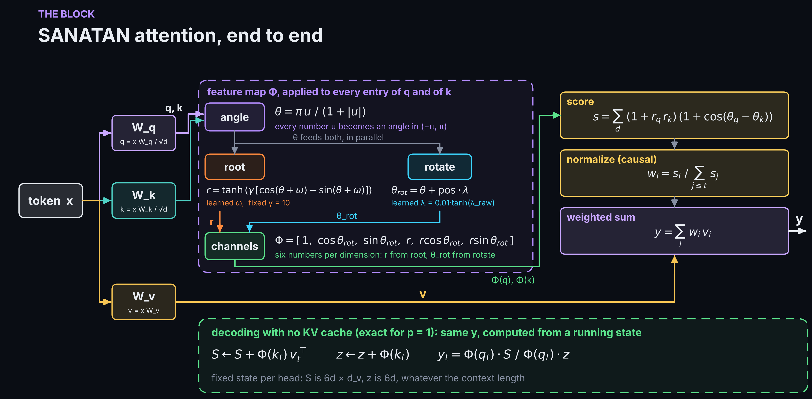

# SANATAN: Root-Parity Gated Angular Attention

Linear attention with an exact constant-state recurrent form, built from the two matrix
roots of i^2 = -1. Each feature dimension of a token softly selects one of the two roots;
the resulting d-bit label gates per-dimension query-key interaction inside an angular
kernel. At p = 1 the whole model runs as a recurrence with a fixed-size state: no KV cache.

**Author:** Bhargav Patel (Independent Researcher) · Paper: [paper/sanatan_v2.pdf](paper/sanatan_v2.pdf) (corrected preprint; arXiv link to follow)


**Where the idea comes from:** the origin story, from the two matrix roots of i^2 = -1 to the gated score, with worked figures: [docs/MOTIVATION.md](docs/MOTIVATION.md)

## Architecture



- **Projections.** q = x W_q / √d, k = x W_k / √d, v = x W_v.
- **Feature map Φ**, applied to every entry u of q and of k:
  - **Angle:** θ = πu / (1 + |u|) maps every entry into (−π, π) without wrapping.
  - From θ, two branches run **in parallel**:
    - **Root:** r = tanh(γ [cos(θ + ω) − sin(θ + ω)]) with learned ω and γ = 10. It is computed
      from the unrotated θ, so a token's position never changes its root.
    - **Rotate:** θ_rot = θ + pos·λ with learned λ = 0.01·tanh(λ_raw), so a query-key comparison
      sees only the distance between the two tokens.
  - **Channels:** Φ = [1, cos θ_rot, sin θ_rot, r, r cos θ_rot, r sin θ_rot] per dimension.
- **Score.** The six channels are chosen so the inner product factorizes exactly:
  Φ(q)·Φ(k) = Σ_d (1 + r_q r_k)(1 + cos(θ_q − θ_k)), a root-parity gate times an angular
  similarity. Both factors are non-negative, so causal normalization is a plain division,
  w_i = s_i / Σ_{j≤t} s_j, with no softmax.
- **Decoding with no KV cache** (exact for p = 1): S ← S + Φ(k_t) v_tᵀ, z ← z + Φ(k_t),
  y_t = Φ(q_t)·S / Φ(q_t)·z. The state per head is fixed at 6d × d_v + 6d numbers, whatever the
  context length. (The paper's p > 1 sharpening used during pretraining is omitted from the diagram.)

## What is in this repo

`SANATAN_demo.ipynb` - a self-contained, CPU-runnable notebook (ships pre-executed) that:

- verifies the algebra and the exact factorization identity
  Phi(q)·Phi(k) = (1 + r_q r_k)(1 + cos dtheta) to machine precision,
- trains a small character-level SANATAN model on tiny-Shakespeare in about 90 seconds,
- **verifies the exact constant-state recurrence**: parallel and recurrent computation of the
  trained model agree to ~4e-6 per logit, identical loss to six decimals,
- generates text token by token from the constant state (no KV cache),
- measures gate statistics (fraction of near-binary roots, leakage through closed gates),
- benchmarks the recurrent step against softmax KV-cache decoding.

Run it top to bottom with: `pip install -r requirements.txt`, then open in Jupyter (or
upload to Google Colab; no GPU required).

## Reproducing the experiments

The notebook above is a self-contained demo. The actual experimental code behind the
paper, including the original submission scripts, the corrected evaluation pipeline,
the matched GLA baseline, and the held-out results of record, lives in
[`experiments/`](experiments/) with its own README.

## Results at scale (from the paper, 184M parameters)

- Exact recurrence verified on the trained model: parallel and recurrent agree within
  1e-4 nats (float32).
- Two-stage recipe (p=2 pretraining, brief p=1 adaptation): the constant-state model
  matches its full parallel parent, 3.951 vs 3.966 held-out loss.
- Constant 14.4 MB state vs a KV cache of 2.4 GB at 32K context; decode latency
  0.153 ms/token constant in n, a 3.2x to 48x advantage over softmax decoding from
  1K to 32K context.
- Root-parity gating contributes +0.53 nats over the ungated angular kernel.

**Honest status:** gating is per-dimension (2^d counts labels, not isolated memory
sectors); the constant-state property holds only for p=1-trained models; and at this
scale SANATAN outperforms the evaluated pre-2022 constant-memory baselines under a
shared recipe while remaining behind matched-recipe Gated Linear Attention (3.348).
Closing that gap, or transferring root-parity gating into such architectures, is open
research and the direction of ongoing work.

## Citation

```bibtex
@article{patel2026sanatan,
  title  = {SANATAN: Root-Parity Gated Angular Attention with an Exact Constant-State Recurrent Form},
  author = {Patel, Bhargav},
  year   = {2026},
  note   = {Preprint}
}
```

## License

MIT (see LICENSE).
