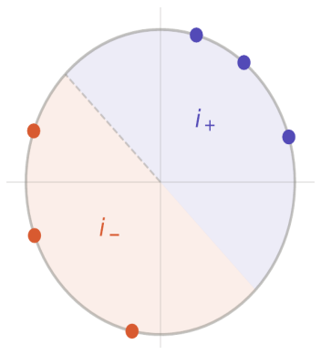
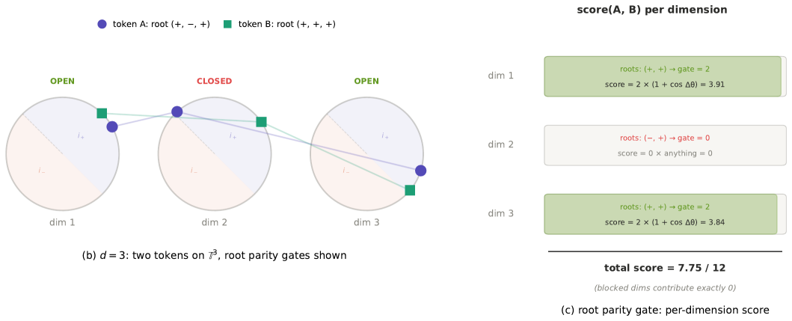

# SANATAN: Where the Attention Comes From

SANATAN's attention grows from a single idea: the imaginary unit has **two** roots, and
each dimension of a token softly picks one. Everything else follows from that.

## Two roots

The equation i^2 = -1 has two orthogonal matrix solutions, i_plus and i_minus: a rotation
by +90 degrees and by -90 degrees. Picture a circle split into an i_plus half and an
i_minus half.

*The two roots i_plus and i_minus split the circle; a token's phase theta leans toward one.*

Their continuous combination is

> S(theta) = cos(theta) * i_plus + sin(theta) * i_minus

and its off-diagonal entry is +/-(cos theta - sin theta). That combination
**cos theta - sin theta** is where SANATAN's core quantity comes from: its sign says
which root the direction theta leans toward (it flips at theta = pi/4).

## Content sets the angle

Where does theta come from? From the tokens. We project each token to queries, keys, and
values the usual way (q = x W_q / sqrt(d), and likewise k, v), then squash each
projection u into a bounded angle:

> theta = pi * u / (1 + |u|)

So a token's actual content decides where it sits on the circle: its phase.

The phase also carries *position*: a learned per-dimension rate lambda rotates it with
the token's index t,

> theta = theta_content + t * lambda

so a difference of phases encodes relative position, as in RoPE. (In the evaluated
models lambda is learned from a zero initialization and the trained context also carries
a learned absolute positional embedding; see the paper for what the ablations actually
support at this scale.)

## Picking a root, softly

Each dimension should commit to i_plus or i_minus: a +/-1 choice. A hard sign would do
it but has no gradient, so we use **tanh**, which saturates smoothly to +/-1:

> r = tanh( gamma * ( cos(theta + omega) - sin(theta + omega) ) ) ~ +/-1

tanh gives a differentiable soft binary: gamma sets how sharply it snaps to +/-1, and the
learned anchor omega shifts the split off the fixed pi/4 so the model can learn where to
divide the circle.

## The feature map and the score

Collecting the angle and the root into one feature vector:

> Phi(x) = [ 1, cos theta, sin theta, r, r cos theta, r sin theta ]

whose six coordinates are: a constant 1, the phase (cos theta, sin theta), the root r,
and the phase gated by the root. Taking the dot product of two such features makes the
attention score exactly a root gate times a phase similarity:

> < Phi(q), Phi(k) > = (1 + r_q r_k)(1 + cos d_theta)

The gate (1 + r_q r_k) is 0 or 2 for hard roots, and (1 + cos d_theta) measures how
close the two phases are. Same root: the two tokens attend by phase closeness. Opposite
roots: the score is zero (exactly zero in the hard-root idealization; the trained soft
gate leaks about 3 percent, which the paper measures). That is the whole mechanism.

*A worked example (d = 3): tokens A and B share a root in dims 1 and 3, so those gates
are open and they score by phase; they differ in dim 2, so that gate is closed and
contributes zero. Total 7.75 of 12.*

Turning the score into attention needs only a normalization; a power p sharpens the
weights and preserves the gate's zeros (which an exponential would erase). The output is
the value-weighted sum:

> attn(t, j) = ( s(t,j) / 4d )^p / sum_j' ( s(t,j') / 4d )^p
>
> out(t) = sum_j attn(t, j) * v(j)

Because the score is an inner product, at p = 1 the same output can be read from a
constant-size state, with keys folding in as they arrive instead of piling up in a cache:

> out = < Phi(q), S > / < Phi(q), z >,  where  S = sum Phi(k) (x) v,  z = sum Phi(k)

S is a running sum of each key feature times its value, and z a running sum of the key
features (the normalizer); a query reads its output straight from these two fixed-size
arrays, so no per-token cache is kept. This recurrence is exact only for p = 1; the
paper measures why p > 1 models cannot be deployed this way, and gives the two-stage
recipe that preserves quality under the exact constant state.

## Where it stands

The verified results, all on a common seeded held-out protocol, are in the
[paper](../paper/sanatan_v2.pdf) and summarized in the repository
[README](../README.md): the exact constant-state model matches its full parallel parent
(3.951 vs 3.966), decodes with a fixed 14.4 MB state at a 3.2x to 48x latency advantage
over softmax KV-caching from 1K to 32K context, and outperforms the evaluated pre-2022
constant-memory baselines, while matched-recipe Gated Linear Attention remains ahead.
The open questions, and the follow-up architecture, are in the paper's final section.
